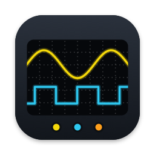
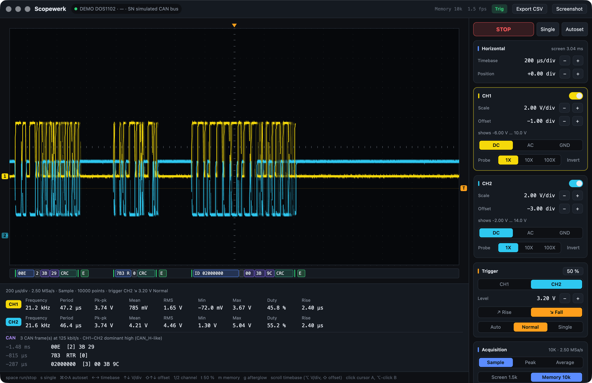
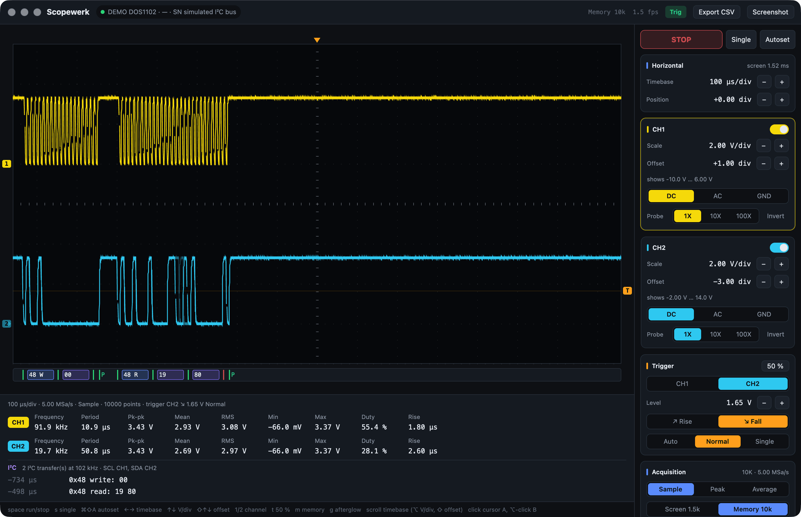
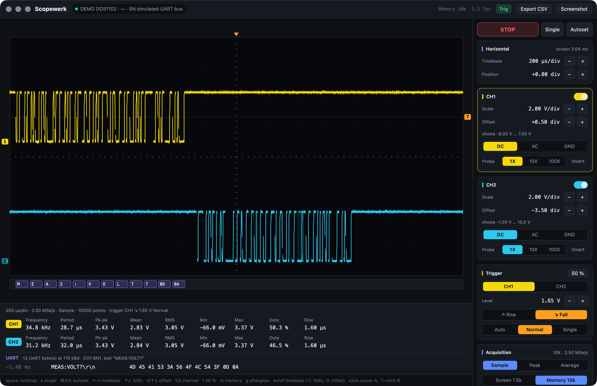

<p align="center">
  
</p>

<h1 align="center">Scopewerk</h1>

<p align="center">
  <strong>The Hanmatek DOS1102 oscilloscope on your desktop</strong>: a native app, a two-channel
  logic analyzer, a command line tool and an MCP server for AI agents.<br>
  Pure Rust over USB. No Python, no VISA, no vendor software.
</p>

<p align="center">
  <a href="https://github.com/mneuhaus/scopewerk/releases/latest"></a>
  <a href="https://github.com/mneuhaus/scopewerk/actions/workflows/ci.yml"></a>
  
  <a href="LICENSE"></a>
</p>

<p align="center">
  <a href="https://mneuhaus.github.io/scopewerk/">Website</a> ·
  <a href="https://github.com/mneuhaus/scopewerk/releases/latest">Download</a> ·
  <a href="#mcp-server-for-agents">MCP server</a> ·
  <a href="#logic-analyzer">Logic analyzer</a>
</p>



## What it does

- **A real scope screen.** Live traces with afterglow on square divisions like the instrument
  (15.2 × 8), ground and trigger markers, hover readout, A/B cursors with Δt, 1/Δt and ΔV, and
  automatic measurements: frequency, period, pk-pk, mean, RMS, min, max, duty cycle, rise time.
- **Every control.** Timebase, position, V/div, offset, coupling, probe, invert, trigger source,
  level, edge, sweep, acquisition mode, run/stop, single, autoset, all from the keyboard as well.
- **Logic analyzer.** CAN, I²C, SPI and UART decoded from the 10 000-sample memory of every frame,
  with a protocol lane under the traces and a table of decoded events.
- **Agents welcome.** `scopewerk mcp` gives Claude, Codex and other MCP clients ten tools to read,
  configure and decode the scope. While the app is open, agents work *through* it, so you see
  every change live and in the activity log.
- **Verified, not hoped.** The firmware silently ignores values it does not like. Scopewerk reads
  every change back and reports what the scope actually did, snapped to its 1-2-5 steps.
- **Exports.** CSV at full resolution, the scope's own display as PNG, measurements to the
  clipboard, JSON from every CLI command.

## Download

| Platform | Download |
| --- | --- |
| macOS 11+ (Apple Silicon and Intel) | [Scopewerk-1.0.0-macos-universal.dmg](https://github.com/mneuhaus/scopewerk/releases/download/v1.0.0/Scopewerk-1.0.0-macos-universal.dmg) · CLI only: [tar.gz](https://github.com/mneuhaus/scopewerk/releases/download/v1.0.0/scopewerk-cli-1.0.0-macos-universal.tar.gz) |
| Windows 10/11 (x64) | [Scopewerk-1.0.0-windows-x64.zip](https://github.com/mneuhaus/scopewerk/releases/download/v1.0.0/Scopewerk-1.0.0-windows-x64.zip) · CLI only: [zip](https://github.com/mneuhaus/scopewerk/releases/download/v1.0.0/scopewerk-cli-1.0.0-windows-x64.zip) |

Checksums are attached to the [release](https://github.com/mneuhaus/scopewerk/releases/latest).

**macOS.** Drag Scopewerk to Applications. The build is ad-hoc signed but not notarized, so the
first start needs a right-click on the app → *Open* (or
`xattr -dr com.apple.quarantine /Applications/Scopewerk.app`). The command line tool is inside
the app: `/Applications/Scopewerk.app/Contents/MacOS/scopewerk`.

**Windows.** Unzip anywhere and start `Scopewerk.exe` (SmartScreen: *More info* → *Run anyway*;
the download is not code-signed). The CLI is `cli\scopewerk.exe`. Windows needs the generic
WinUSB driver for the scope, installed once with [Zadig](https://zadig.akeo.ie): *Options → List
All Devices*, pick **Oscilloscope** (USB ID `5345 1235`), choose **WinUSB**, *Replace Driver*.
Scopewerk tells you if the scope is still on another driver.

Connect the **square USB-B port on the back** of the scope (the USB-A port on the front is for
memory sticks). Scopewerk finds the scope on its own and reconnects when it is unplugged.

No scope at hand? `SCOPEWERK_DEMO=can` (or `i2c`, `uart`) starts the app on a simulated bus.

## Logic analyzer

The Decode panel in the app, `scopewerk decode …` and the `decode_bus` MCP tool decode the
acquisition memory. With two channels the DOS1102 covers:

| Protocol | Wiring | Found automatically | Checked |
| --- | --- | --- | --- |
| CAN 2.0A/B | CAN_H, CAN_L or a transceiver RX pin on one channel, or CAN_H/CAN_L on CH1/CH2 (`ch1-ch2`) | bitrate, polarity, threshold | CRC-15, bit stuffing, ACK slot, error flags |
| I²C | SCL + SDA | thresholds, clock | START, repeated START, STOP, address + R/W, ACK/NACK |
| SPI | clock + one data line | CPOL from the idle clock, clock rate | words split at clock pauses (there is no third channel for chip select) |
| UART | one line | baud rate, snapped to standard rates | framing, parity; bytes grouped into lines |

<p>
  
  
</p>

The scope samples 500 points per division, so the timebase sets the samples per bit. About ten
are plenty: **timebase ≤ 50 / bitrate**, e.g. 200 µs/div for 125 kbit/s CAN (a 2 ms window with
three frames). Scopewerk warns and offers the right timebase when there are too few. To catch a
rare frame, trigger on the bus (CAN_L, falling edge, level mid-swing, sweep Normal) and use single
shot.

```sh
scopewerk decode can --input ch1-ch2               # differential, everything detected
scopewerk decode can --bitrate 125k --single 10    # arm and wait up to 10 s for a frame
scopewerk decode i2c --scl 1 --sda 2
scopewerk decode spi --clk 1 --data 2 --mode 0
scopewerk decode uart --baud 115200
```

## MCP server for agents

`scopewerk mcp` is a Model Context Protocol server on stdio. Register it once:

```sh
# Claude Code (macOS)
claude mcp add --scope user scopewerk -- /Applications/Scopewerk.app/Contents/MacOS/scopewerk mcp

# Codex (~/.codex/config.toml)
[mcp_servers.scopewerk]
command = "/Applications/Scopewerk.app/Contents/MacOS/scopewerk"
args = ["mcp"]
```

Claude Desktop (`claude_desktop_config.json`), with the Windows path as an example:

```json
{
  "mcpServers": {
    "scopewerk": { "command": "C:\\Tools\\Scopewerk\\cli\\scopewerk.exe", "args": ["mcp"] }
  }
}
```

| Tool | What it does |
| --- | --- |
| `scope_status` | identity, connection path, every setting incl. the visible voltage range |
| `capture_waveform` | measurements, warnings (clipping, poor V/div use), a plot image, optional samples and CSV |
| `configure_scope` | any settings in one call, each read back and reported |
| `run_control` | run, stop, single, autoset |
| `single_shot` | arm, wait for the trigger, return the capture |
| `monitor_levels` | min/mean/max/frequency over time, e.g. while a device powers up |
| `decode_bus` | logic analyzer: CAN, I²C, SPI, UART with detected parameters, events and a plot |
| `scope_screenshot` | the scope's real display as PNG |
| `scope_measurements` | the scope's built-in measurements |
| `send_scpi` | raw SCPI escape hatch |

Things to ask an agent: *"Set CH1 to 1 V/div with 0 V two divisions down and tell me the frequency
on it"*, *"Watch CH2 for 20 s while I power the board and tell me when it drops below 3 V"*,
*"Decode the CAN bus on CH1 minus CH2 and list the IDs you see"*.

## Command line

```sh
scopewerk status                       # identity, connection, every setting
scopewerk capture                      # measurements of what is on screen
scopewerk capture --memory --csv bus.csv --png bus.png
scopewerk set timebase=1ms ch1.scale=500mV ch1.offset=-2 trigger.level=1.2V trigger.edge=fall
scopewerk single --timeout 30 --csv event.csv
scopewerk watch 60 --log levels.jsonl  # levels twice a second
scopewerk screenshot scope.png
scopewerk scpi ':CH1:SCALe?'           # raw SCPI
```

Add `--json` to any command for machine-readable output; `scopewerk set --help` lists every key.
The CLI and the MCP server go through the app when it is open (one process owns the USB
interface) and straight to USB otherwise.

## Keyboard

| Key | Action |
| --- | --- |
| `space` | run / stop |
| `s` | single shot |
| `⌘⇧A` / `Ctrl+Shift+A` | autoset |
| `←` `→` | timebase faster / slower |
| `↑` `↓` | V/div of the selected channel |
| `⇧↑` `⇧↓` | offset of the selected channel |
| `1` `2` | select a channel; `⌘1` / `Ctrl+1` switches it on or off |
| `t` | trigger level to 50 % of the signal |
| `m` | screen (1 520 points) or memory (10 000 samples) |
| `g` / `p` | afterglow / pause the live view |
| click, `⌥`/`Alt`-click, `esc` | cursor A, cursor B, clear |
| scroll | timebase (`⌥`/`Alt` V/div, `⇧` offset) |
| `⌘E` / `Ctrl+E` | export CSV |
| `⌘⇧S` / `Ctrl+Shift+S` | save the scope's display (Pictures/Scopewerk) |
| `⌘⇧C` / `Ctrl+Shift+C` | copy measurements |

## How the DOS1102 talks (firmware V1.5.0, USB `5345:1235`)

The scope is a USBTMC device speaking OWON's SDS SCPI dialect. Everything below was measured on
the instrument:

- Screen data `:DATA:WAVE:SCREen:CHn?`: 1 520 little-endian `i16` points across 15.2
  divisions behind a 4-byte length prefix; the header `:DATA:WAVE:SCREen:HEAD?` is JSON.
- **Scaling: 400 counts per division, offsets in 1/50 division (8 counts per offset pixel).**
  These match the scope's own `:MEAS` min/max/pk-pk exactly; the 410 and 8.25 used by earlier
  wrappers read 2–3 % off.
- The header's channel `SCALE` is input-referred: with a 10X probe the scope's measurements read
  ten times higher while `SCALE` stays the same, so Scopewerk multiplies by the probe factor.
- Memory `:DATA:WAVE:DEPMem:CHn?`: 10 000 samples at the real sample rate, which is
  500 points per division of the timebase (the record length is fixed at 10K over USB). Its
  header has no trigger block.
- Screenshot `:DATA:WAVE:SCREen:BMP?`: an 800 × 480 BMP (1.15 MB, about 1.6 s). It must be
  requested in one USBTMC transfer, and the firmware then queues a stray `"…->\n"` message that
  has to be read and dropped.
- Each data query takes about 250 ms inside the scope (USB itself takes microseconds), so a live
  view of both channels runs at about 1.5 frames per second, one channel about 2.5.
- Settings: `:HORIzontal:SCALe 1.0ms` (a bare `1ms` is ignored), `:HORIzontal:OFFSet <div>`,
  `:CHn:SCALe 500mV`, `:CHn:OFFSet <div>`, `:CHn:COUPling DC|AC|GND`, `:CHn:PROBe 10X`,
  `:CHn:DISPlay ON|OFF`, `:CHn:INVerse ON|OFF`, `:TRIGger:SINGle:EDGE:SOURce|SLOPe|LEVel|COUPling`,
  `:TRIGger:SINGle:SWEep AUTO|NORMal|SINGle`, `:RUNning RUN|STOP`, `:ACQuire:MODE SAMPle|PEAK|AVERage`.
  Set commands answer with an empty message; queries end in `->\n`.
- A program killed mid-transfer leaves the pipes stalled. Scopewerk clears them when it opens the
  scope (USBTMC INITIATE_CLEAR, endpoint halts, drain) and resets the device on the bus if that
  is not enough. A firmware that stops answering altogether needs a power cycle.

Older firmware (`5345:1234`, raw bulk without USBTMC framing) is detected and handled the way
[danielphili/hanmatek_DOS1102_python_wrapper](https://github.com/danielphili/hanmatek_DOS1102_python_wrapper)
describes, but is untested. Other OWON SDS-family scopes may work with small changes.

## Building from source

Rust (stable) and, on macOS, Xcode's command line tools (GPUI compiles Metal shaders).

```sh
cargo run -p scopewerk-app                 # the app
cargo run -p scopewerk-cli -- status       # the CLI
SCOPEWERK_DEMO=i2c cargo run -p scopewerk-app
scripts/bundle-macos.sh --install          # Scopewerk.app into /Applications
scripts/release-macos.sh                   # universal DMG + CLI tarball into dist/release
cargo test --workspace
```

| Crate | Contents |
| --- | --- |
| `scopewerk-core` | USB driver on [nusb](https://github.com/kevinmehall/nusb), header and waveform model, verified changes, protocol decoders, PNG output, the broker |
| `scopewerk-cli` | the `scopewerk` binary: CLI and MCP server |
| `scopewerk-app` | the app, built on [GPUI](https://www.gpui.rs) via gpui-kit |

Environment switches for the app: `SCOPEWERK_DEMO=can|i2c|uart` (simulated bus),
`SCOPEWERK_BACKGROUND=1` (a non-activating window that never takes keyboard focus, for scripted
screenshots), `SCOPEWERK_WINDOW=1600x1000` (initial size), `SCOPEWERK_TRACE=1` (log every SCPI
exchange), `SCOPEWERK_SOCKET=<path>` (broker socket on macOS/Linux).

## Credits

Protocol facts from Daniel Philipps'
[Python wrapper](https://github.com/danielphili/hanmatek_DOS1102_python_wrapper), OWON's SDS SCPI
documentation, and a lot of measuring. Scopewerk is an independent implementation and not
affiliated with Hanmatek or OWON.

## License

[MIT](LICENSE)
